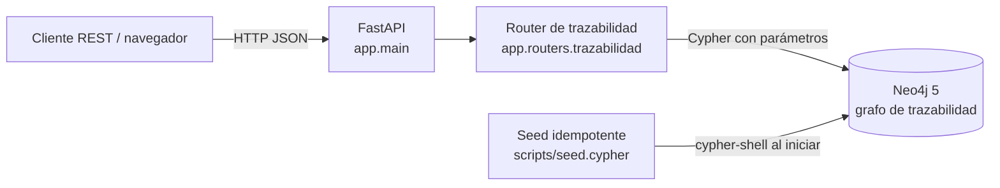
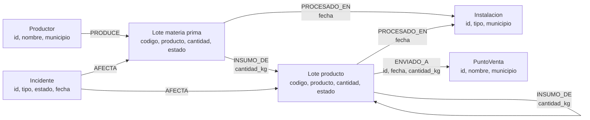
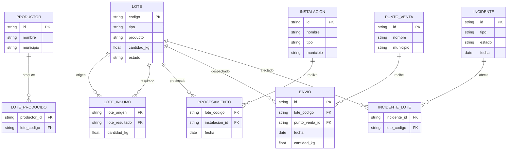

# Arquitectura y modelos de datos

## Arquitectura de ejecución

Docker Compose levanta Neo4j, ejecuta el seed después del healthcheck y luego
inicia la API. Las rutas de consulta usan el driver oficial de Neo4j; las
etiquetas y tipos de relación del grafo se detallan abajo.

## Modelo del grafo

`INSUMO_DE` apunta del lote de origen al lote que lo incorpora; por eso la
traza hacia atrás recorre las relaciones en sentido inverso y la traza hacia
adelante las recorre en sentido de la flecha. Cada envío tiene un identificador
en la relación `ENVIADO_A`, lo cual permite guardar varias entregas del mismo
lote al mismo punto de venta.

## Comparación con un modelo relacional

| Aspecto | Grafo Neo4j | Relacional |
| --- | --- | --- |
| Relaciones | `PRODUCE`, `INSUMO_DE`, `PROCESADO_EN`, `ENVIADO_A` y `AFECTA` son relaciones explícitas con propiedades cuando corresponde. | Las relaciones se representan mediante claves foráneas y tablas de unión (`LOTE_INSUMO`, `ENVIO`, etc.). |
| Trazabilidad de varios niveles | Recorrido variable como `[:INSUMO_DE*0..]` y acceso directo a vecinos. | Requiere CTE recursivo o consultas recursivas con uniones repetidas. |
| Integridad e identidad | Restricciones únicas para identificadores de nodos; identidad propia para cada relación de envío. | PK/FK, restricciones `UNIQUE` y tablas de unión proporcionan integridad referencial. |
| Consulta por relaciones | Natural para rutas, impacto de incidentes y propagación entre lotes. | Adecuado para registros tabulares y agregaciones; los caminos recursivos requieren lógica adicional. |
| Coste principal | Las consultas de recorrido dependen del tamaño y ramificación de las rutas. | Los recorridos de profundidad variable dependen de uniones recursivas y sus índices. |

El esquema relacional del diagrama es una traducción conceptual equivalente,
no una segunda base de datos implementada en este proyecto.
